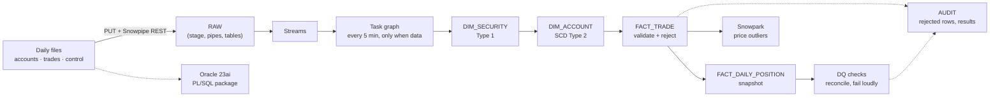

# Snowflake Incremental Data Warehouse

I built an incremental data warehouse for a broker's daily **account** and **trade** files. Files land in Snowflake and are loaded automatically by **Snowpipe**. **Streams** and a scheduled **Task graph** load an **SCD Type 2** account dimension, a **transaction fact** and a **daily position snapshot**. Every file is **reconciled against the sender's control totals**, bad rows go to an audit table, and a **Snowpark** check flags suspicious prices. I also rebuilt the same load in **Oracle PL/SQL** and compared the results count for count.

> **All data is synthetic**: I generate it with `generator/generate_files.py` (seed 42). Every number below comes from a real run, and I recorded each one in [`docs/results.md`](docs/results.md).

## Architecture



More detail in [`docs/architecture.md`](docs/architecture.md) and [`docs/data_model.md`](docs/data_model.md).

## Results (30 business days, 2026-09-01 to 2026-10-12)

| What | Result |
|---|---|
| Files | 92 generated (30 accounts, 30 trades, 30 control, securities, manifest); 60 control files reconciled, **60 PASS** |
| Trades | 60,031 sent → **59,853 loaded + 178 rejected**; sender control totals match to the cent ($7,316,162,275.22) |
| Rejected rows | Exactly the 178 planted bad rows, by trade_id and reason (41 missing account, 46 negative quantity, 45 unknown security, 46 duplicate trade_id) |
| SCD Type 2 | 893 account rows → **806 versions** (538 current, 268 closed); 87 unchanged re-sends ignored; up to 4 versions per account |
| Daily positions | 648,618 snapshot rows over 30 days; 0 rows differ from the running sum of trades |
| Automation | Days 3–30 (84 files) uploaded at once; the next scheduled tick loaded all 28 days in **one 45 s graph run** with no manual step |
| Data quality | Latest DQ run: 230 checks PASS, 0 FAIL; Snowpark price check: 0 of 59,853 trades flagged (max deviation 0.75 % vs a 5 % threshold) |
| Oracle PL/SQL | Same files through `pkg_load`: 806 / 538 / 59,853 / $7,305,865,118.44 / 178, **identical to Snowflake**; 150 reconciliation checks PASS |
| UAT | [`docs/uat_checklist.md`](docs/uat_checklist.md): **13 of 13 PASS** (generated from a real run) |
| Tests | **62 passed** in one run (27 offline + 35 against a temporary Snowflake database), 11 min 32 s |
| Cost | 1.59 of the 20-credit monthly cap used (X-Small warehouse, auto-suspend 60 s) |

## What I built

- **Snowpipe via REST** on an internal stage, with key-pair (JWT) auth. Re-sending a file does not load it twice.
- **Streams + Tasks.** A 5-task graph is gated on `SYSTEM$STREAM_HAS_DATA`, so idle runs are SKIPPED without starting the warehouse. Runs never overlap, failed runs retry, and a task suspends itself after 3 failures.
- **SCD Type 2 with MERGE.** Change detection uses a hash. Multi-day catch-up batches are chained in date order, out-of-order rows are rejected, and replays are ignored. Each run is one transaction.
- **Two fact designs.** A transaction fact keyed to the account version in force on the trade date, and a periodic snapshot rebuilt incrementally from the earliest new trade date (so late trades correct later days).
- **Reconciliation and control totals.** Each file is checked three ways (sender control → RAW → loaded + rejected). A file stays PENDING until its data has landed. Evidence is committed before the error is raised, so failures are loud and auditable.
- **Snowpark.** A leave-one-out VWAP price-outlier check written with the DataFrame API, tested offline in local testing mode.
- **Oracle PL/SQL.** A package with MERGE-based SCD2, `RAISE_APPLICATION_ERROR` / `PRAGMA EXCEPTION_INIT` error handling, and an autonomous-transaction logger whose rows survive a rollback.
- **Testing.** Unit, SCD2, fact, snapshot, DQ, task-graph and end-to-end integration tests run against a temporary Snowflake database built from the same SQL files. There is also a UAT checklist.

## Repository layout

```
generator/   generate_files.py (synthetic files + manifest), upload_to_stage.py (PUT + Snowpipe REST)
snowflake/   00_setup … 11_tuning.sql, run in numeric order (see "How to run")
snowpark/    dq_checks.py (price-outlier check)
oracle/      schema.sql, pkg_load.sql (PL/SQL package), run_oracle.py (load + compare with Snowflake)
scripts/     run_sql.py, tasks.py (status/resume/suspend/run-once), check_connections.py, tuning.py, uat.py
tests/       unit tests + Snowflake-backed tests (RUN_SNOWFLAKE_TESTS=1)
docs/        architecture.md, data_model.md, results.md, uat_checklist.md
```

## How to run

Prerequisites: Python 3.11, a Snowflake account (the trial is enough), and Docker for the Oracle part.

```bash
python3.11 -m venv .venv && .venv/bin/pip install -r requirements.txt
cp .env.example .env    # fill in the Snowflake account and user; key pair in ~/.snowflake/keys (see .env.example)
.venv/bin/python -m scripts.check_connections

# 1. Generate the synthetic files
.venv/bin/python generator/generate_files.py --out data/raw

# 2. Build Snowflake (00 as ACCOUNTADMIN; the rest as DW_ROLE, in this order)
for f in snowflake/0{0..9}_*.sql snowflake/10_*.sql; do .venv/bin/python -m scripts.run_sql "$f"; done
.venv/bin/python -m scripts.tasks resume

# 3. Land files; the schedule does the rest
.venv/bin/python -m generator.upload_to_stage --date 2026-09-01 --reference
.venv/bin/python -m generator.upload_to_stage --date 2026-09-02 --through 2026-10-12

# 4. Checks
.venv/bin/python -m snowpark.dq_checks
.venv/bin/python -m scripts.uat
.venv/bin/python -m scripts.tasks status

# Oracle 23ai
docker run -d --name broker-dw-oracle -p 1522:1521 -e ORACLE_RANDOM_PASSWORD=yes \
  -e APP_USER=broker_dw -e APP_USER_PASSWORD=<from .env> gvenzl/oracle-free:23-slim-faststart
.venv/bin/python -m oracle.run_oracle
```

## Testing

```bash
.venv/bin/pytest                          # offline tests (generator, upload paths, task graph shape, Snowpark local testing)
RUN_SNOWFLAKE_TESTS=1 .venv/bin/pytest    # + tests against a temporary BROKER_DW_TEST database, dropped afterwards
```

Last full run: **62 passed** (27 offline, 35 Snowflake-backed: SCD2 8, trade fact 8, positions 6, data quality 5, task graph 1, Snowpark 1, end-to-end integration 6).

Issues identified and resolved through testing:
- Load-log inserts name their columns, so schema changes in later steps cannot break earlier procedures.
- Task monitoring reads `TASK_HISTORY`, because SKIPPED runs are not listed in `COMPLETE_TASK_GRAPHS`.
- Raw tables build before pipes, because a pipe is validated against its target table at creation.
- The first read of a `SHOW_INITIAL_ROWS` stream returns only the initial snapshot; tests and stream DDL account for it.

## Design notes

- **Ingestion.** Files are staged in a Snowflake internal stage and Snowpipe is triggered through its REST API with key-pair authentication. The same pipes run on an S3 external stage with event-driven `AUTO_INGEST`; only the landing layer changes.
- **Performance.** At this volume each fact table is a single micro-partition (59,853 rows / 1.9 MB and 648,618 rows / 10.7 MB), so a clustering key cannot prune and was not applied; the production key (`trade_date`, `position_date`) is documented in `snowflake/11_tuning.sql`. A window-function + `ASOF JOIN` rewrite of the position check scanned 46 % fewer bytes with the same elapsed time (median 329 ms vs 338 ms). Details in [`docs/results.md`](docs/results.md).
- **Data.** The synthetic feed allows sales without a prior holding, so positions can be short, and the business calendar is weekdays only.

## Next steps

- Register the Snowpark price check as a Python stored procedure and add it to the task graph.
- Email alerts on failed task runs through a notification integration.
- S3 landing with event-driven `AUTO_INGEST` for the pipes.
