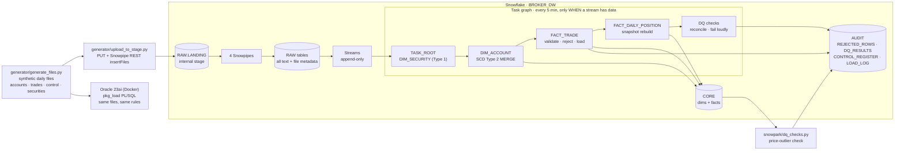

# Architecture

## Flow

1. **Files.** A broker sends three files per business day (accounts, trades, control totals) plus a security master. They are synthetic, from `generator/generate_files.py`, with bad rows planted on purpose and listed in `manifest.json`.
2. **Landing.** `upload_to_stage.py` PUTs each file to the internal stage `RAW.LANDING` and notifies the feed's Snowpipe through the REST API (`insertFiles`, key-pair JWT). The same pipes can run on an S3 external stage with event-driven AUTO_INGEST; only the landing layer changes.
3. **RAW.** Snowpipe copies each file into a RAW table. Every business column is text, so a bad value never fails a load. File name, row number and load time are kept for lineage.
4. **Change capture.** Append-only streams on the RAW tables expose only rows that have not been processed yet.
5. **Task graph.** Runs every 5 minutes, but the root's `WHEN SYSTEM$STREAM_HAS_DATA(...)` skips the run without starting the warehouse when nothing new has landed. Each task calls one stored procedure that runs as a single transaction, so a failed run leaves the stream rows for the next run.
6. **Controls.** The DQ task reconciles each file three ways (sender control → RAW → loaded + rejected) and runs global integrity checks. It commits the evidence and then raises an error, so a failure is visible in the task history and in `AUDIT.LOAD_LOG`.
7. **Snowpark.** `snowpark/dq_checks.py` adds a statistical check (trade price vs same-day peer VWAP) using the DataFrame API, pushed down to Snowflake.
8. **Oracle.** The same SCD2 load, trade validation and reconciliation as a PL/SQL package, run on the same files and compared count for count.

## Schemas

| Schema | Contents |
|---|---|
| RAW | Landing stage, 4 pipes, 4 RAW tables, 4 streams |
| STAGE | Reserved (validation runs in temporary tables inside each procedure) |
| CORE | DIM_ACCOUNT, DIM_SECURITY, FACT_TRADE, FACT_DAILY_POSITION, load procedures, task graph |
| MART | Reserved for reporting views |
| AUDIT | REJECTED_ROWS, LOAD_LOG, CONTROL_REGISTER, DQ_RESULTS, PRICE_OUTLIERS, reconciliation views, DQ procedure |
