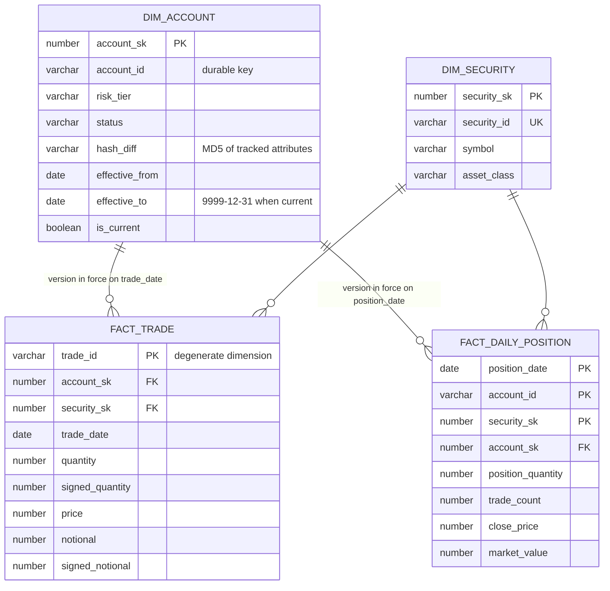

# Data model

## Grains

| Table | Type | Grain |
|---|---|---|
| FACT_TRADE | Transaction fact | One row per valid trade |
| FACT_DAILY_POSITION | Periodic snapshot fact | One row per account × security × business day (end of day) |
| DIM_ACCOUNT | SCD Type 2 | One row per account version |
| DIM_SECURITY | SCD Type 1 | One row per security (latest values) |

## SCD Type 2 rules (DIM_ACCOUNT)

- Versions are dated by the file's business date (`file_date`), not the load time, so facts can be joined to the version in force on the trade or snapshot date.
- `hash_diff` is the MD5 of name, type, address, city, state, postal code, risk tier, status and open date.
  - **New** account: insert a version from `file_date` to 9999-12-31, current.
  - **Changed** account: close the current version (`effective_to = new effective_from − 1`, not current) and insert the new version.
  - **Unchanged** re-send: nothing changes.
- **Catch-up:** when several days arrive in one run, the versions are chained in date order within that run.
- **Rejected:** missing ID, invalid status or risk tier, and out-of-order rows (dated on or before the current version, with different values). An identical replay is ignored.
- **Invariants,** checked every DQ run: exactly one current row per account, and contiguous non-overlapping ranges.

## Trade validation (FACT_TRADE)

Each rejected row gets one reason, the first that applies, and is written to `AUDIT.REJECTED_ROWS` with the original record.

1. Missing trade, account or security ID.
2. Invalid date.
3. Invalid, negative or zero quantity.
4. Invalid price or side.
5. Notional ≠ quantity × price (more than 0.01 apart).
6. Settlement date before the trade date.
7. Unknown security.
8. Unknown account, meaning no version in force on the trade date.
9. Account not active on the trade date.
10. Duplicate trade_id, either already loaded or repeated within the batch.

## Daily positions

- `position_quantity` is the running sum of signed quantity per account (durable `account_id`) and security. It can be negative (short), because the synthetic feed does not enforce holdings.
- A row exists when the position is non-zero or the pair traded that day.
- `close_price` is the last trade price on or before the day, and `market_value = position_quantity × close_price`.
- Loading is incremental: a stream on FACT_TRADE gives the earliest new trade date, and the snapshot is rebuilt from that date forward. A late trade therefore corrects every later day.
